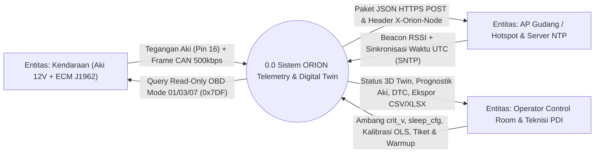
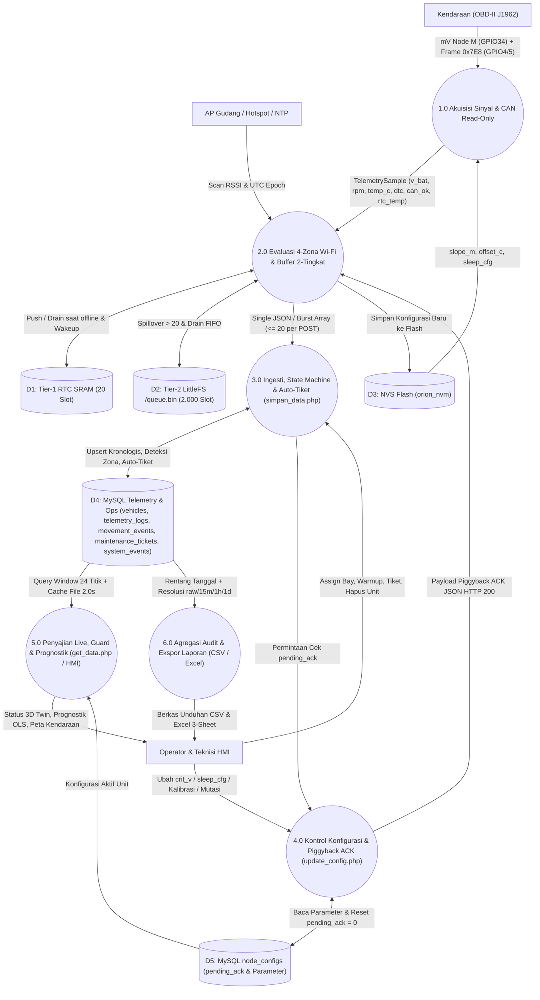
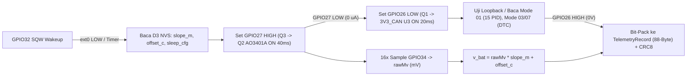
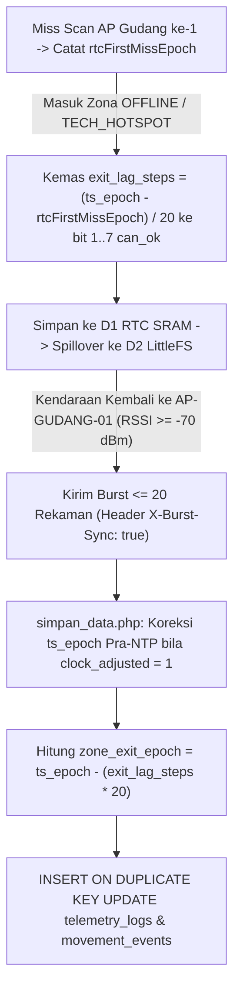

# Diagram Alir Data Sistem ORION (DFD Level 0, 1, dan 2)

Halaman ini mendokumentasikan aliran data berjenjang pada sistem **ORION Telemetry & Digital Twin** mulai dari sinyal analog/CAN di papan [PCB v2.0 Step 2.1](../hardware/pcb-v2-blueprint-layout.md), pemrosesan firmware [ESP32 v1.6.0](../firmware/telemetry-struct.md), ingesti PHP/MySQL, hingga konsol HMI dan laporan ekspor.

---

## 1. DFD Level 0 (Diagram Konteks)

Diagram konteks memperlihatkan batas sistem **ORION Telemetry & Digital Twin** serta pertukaran data utama dengan tiga entitas eksternal di lapangan: **Kendaraan & Port OBD-II**, **Infrastruktur Jaringan Wi-Fi & NTP**, dan **Operator / Teknisi Stock Yard**.

---

## 2. DFD Level 1 (Dekomposisi Proses Utama `1.0` - `6.0`)

Pada Level 1, sistem dibagi menjadi enam proses fungsional (`1.0` s/d `6.0`) yang berinteraksi melalui lima tempat penyimpanan data (*Data Store*) persisten maupun memori volatil terproteksi (`D1` s/d `D5`).

### Kamus Proses & Tempat Penyimpanan Data (DFD Level 1)

| Kode | Nama Proses / Data Store | Lokasi Implementasi | Masukan & Keluaran Inti |
| :--- | :--- | :--- | :--- |
| **`1.0`** | Akuisisi Sinyal & CAN Read-Only | [sketch_oct16aa.ino](file:///d:/magang/v1/pixel-twin-workbench/firmware/sketch_oct16aa/sketch_oct16aa.ino) | Memicu `GPIO27` (`40 ms`) & `GPIO26` (`20 ms`); mengubah `adc_raw_mv` menjadi `v_bat` dan menanyakan PID `0x01`/`0x03`/`0x07`. |
| **`2.0`** | Evaluasi 4-Zona Wi-Fi & Buffer 2-Tingkat | [sketch_oct16aa.ino](file:///d:/magang/v1/pixel-twin-workbench/firmware/sketch_oct16aa/sketch_oct16aa.ino) | Mengklasifikasikan `YARD / TECH_HOTSPOT / OFFLINE`, mengemas `TelemetryRecord` (`88 byte`), atau menyangga ke `D1`/`D2`. |
| **`3.0`** | Ingesti Transaksional & Auto-Tiket | [simpan_data.php](file:///d:/magang/v1/pixel-twin-workbench/backend/dipo_api/simpan_data.php) | Mengurutkan batch (`boot, seq, ts_epoch`), menyaring duplikat idempoten, mencatat keluar-masuk yard, dan membuka tiket kritis otomatis. |
| **`4.0`** | Kontrol Konfigurasi & Piggyback ACK | [update_config.php](file:///d:/magang/v1/pixel-twin-workbench/backend/dipo_api/update_config.php) | Menulis parameter baru ke `node_configs` dengan `pending_ack = 1`, lalu menitipkannya pada respons HTTP `200` `simpan_data.php` berikutnya. |
| **`5.0`** | Penyajian Live & Prognostik HMI | [get_data.php](file:///d:/magang/v1/pixel-twin-workbench/backend/dipo_api/get_data.php), [TelemetryContext.tsx](file:///d:/magang/v1/pixel-twin-workbench/src/context/TelemetryContext.tsx) | Menggunakan micro-cache `2.0 s`, *Mass Disconnect Guard* (`>= 66%`), dan regresi OLS + Arrhenius di frontend. |
| **`6.0`** | Agregasi Audit & Ekspor Multi-Resolusi | `export_csv.php`, `export_excel.php` | Melakukan agregasi berinterval (`raw`, `15m`, `1h`, `1d`) dan mengembalikan berkas CSV/Excel multi-sheet. |
| **`D1`** | Tier-1 RTC SRAM | Memori `RTC_DATA_ATTR` | Kapasitas `20` rekaman x `88 byte` = `1.760 byte`; bertahan selama Deep Sleep tanpa menulis ke Flash. |
| **`D2`** | Tier-2 LittleFS Ring Buffer | `/queue.bin` + `/qmeta.bin` | Kapasitas `2.000` rekaman = `176.000 byte`; ditulis melingkar saat antrean `D1` penuh. |
| **`D3`** | NVS Flash Partition | Namespace `orion_nvm` | Menyimpan `crit_v`, `slope_m`, `offset_c`, `sleep_cfg`, serta `last_ntp_epoch` antar reboot daya penuh. |
| **`D4`** | MySQL Telemetry & Operasional | `vehicles`, `telemetry_logs`, `movement_events`, `maintenance_tickets`, `system_events` | Penyimpanan relasional persisten dengan penguncian baris `SELECT ... FOR UPDATE`. |
| **`D5`** | MySQL Konfigurasi Node | `node_configs` | Menyimpan target kalibrasi per `unit_id` dan bendera antrean `pending_ack`. |

---

## 3. DFD Level 2: Aliran Kritis End-to-End

### Level 2A: Konversi Sinyal PCB v2.0 Menjadi Paket Biner `88-Byte` (Proses `1.0` & `2.0`)

### Level 2B: Aliran Rekonsiliasi Waktu Pra-NTP, Exit Lag `can_ok`, & Burst Sync (Proses `2.0` -> `3.0`)

---

## 4. Keterlacakan Lintas Dokumen

- Rangkaian fisik penghasil `GPIO34` dan `GPIO26`/`GPIO27`: [Alur Kelistrikan Lengkap PCB v2.0](../hardware/electrical-flow.md).
- Tata letak byte struktur `88-byte` pada proses `2.0`: [Struktur Paket Biner 88-Byte](../firmware/telemetry-struct.md).
- Mesin status 4-zona & lag keluar: [State Machine 4-Zona Wi-Fi & NTP Sync](../firmware/wifi-zone-handover.md).
- Implementasi transaksi & respons Piggyback ACK: [Ingest Data & Protokol Piggyback ACK](../backend-api/ingest-and-piggyback.md).
