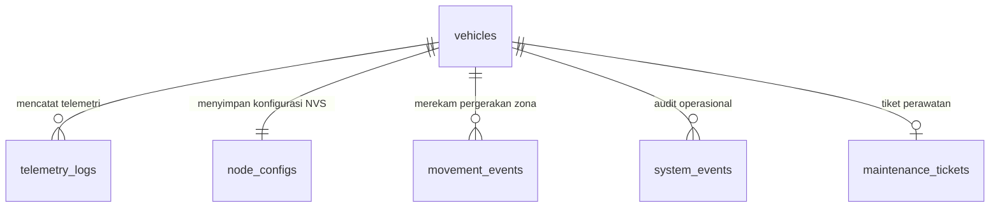

# Skema Basis Data MySQL (`schema_production.sql`)

Seluruh data backend ORION disimpan di atas MySQL 8 dengan mesin penyimpanan InnoDB (`utf8mb4_unicode_ci`, zona waktu sesi `Asia/Jakarta` WIB). Skema dibuat secara idempoten melalui [schema_production.sql](file:///d:/magang/v1/pixel-twin-workbench/backend/dipo_api/schema_production.sql) sehingga aman dijalankan berulang saat instalasi maupun migrasi awal.

## 1. Hubungan Antar Enam Tabel Utama

## 2. Fungsi Setiap Tabel di Lapangan

| Nama Tabel | Kunci Utama & Unik | Peran saat Sistem Berjalan |
| :--- | :--- | :--- |
| `vehicles` | `PK (unit_id)`, Index `bay`, `state` | Menyimpan status terakhir setiap mobil agar layar HMI membukanya seketika tanpa memindai jutaan baris log. |
| `telemetry_logs` | `PK (id)`, `UNIQUE uniq_unit_boot_seq (unit_id, boot, seq)`, Index `idx_unit_created` | Menyimpan riwayat lengkap setiap bangun dari tidur (`35+` kolom). Kunci unik `(unit_id, boot, seq)` memastikan pengiriman ulang *Burst Sync* tidak pernah menggandakan baris. |
| `node_configs` | `PK (unit_id)` | Menyimpan setelan jarak jauh tiap unit (`sleep_cfg`, `fast_poll_s`, `crit_v`, `debounce_cnt`, `cal_slope`, `cal_offset`) beserta bendera `pending_ack` (`0` atau `1`). |
| `movement_events` | `PK (id)`, `UNIQUE uniq_mv_unit_boot_seq_type (unit_id, boot_id, seq_no, event_type)` | Mencatat momen perpindahan `EXIT_YARD` dan `ENTER_YARD`, lama mobil di luar (`away_min`), hitungan debounce, serta label kegiatan (`Test Drive`, `PDI Workshop`, `Detailing`, `Customer Delivery`). |
| `system_events` | `PK (id)`, Index `idx_event_unit_created` | Buku catatan audit permanen (`INFO`, `WARN`, `CRITICAL`) untuk kalibrasi multimeter, pasang/lepas node, pengiriman staf pemanasan, unggahan buffer, dan alarm aki lemah. |
| `maintenance_tickets` | `PK (id)`, `UNIQUE uniq_ticket_unit (unit_id)` | Menyimpan satu tiket kerja aktif per kendaraan (`ticket_code`, ringkasan masalah, status `OPEN` / `IN_PROGRESS` / `RESOLVED`, nama teknisi, dan catatan serah-terima). |

## 3. Pengelompokan Kolom di Tabel `vehicles`

Supaya pembacaan cepat dan aman terhadap paket lama yang datang terlambat, kolom pada tabel `vehicles` terbagi ke dalam tiga kelompok:

1. **Identitas & Lokasi Unit**: `unit_id`, `bay`, `model`, `trim`, `vin`, dan `color` untuk mengenali fisik kendaraan beserta penempatannya di baris parkir diler.
2. **Snapshot Telemetri Terkini**: `state`, `status_label`, `online_status`, `in_yard`, `net_zone`, `sync_ssid`, `v_bat`, `adc_raw_mv`, `rtc_temp_c`, `can_ok`, `rssi`, serta `15` kolom pembacaan OBD-II terakhir.
3. **Pencatat Urutan Paket Terakhir**: `last_boot`, `last_seq`, `last_ts_epoch`, `net_zone_boot`, `net_zone_seq`, dan `net_zone_ts`. Angka urutan ini mencegah paket lama yang baru terunggah dari buffer menimpa status mobil yang lebih baru.
