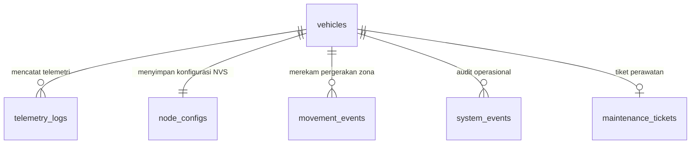

# Skema Basis Data MySQL (`schema_production.sql`)

Backend ORION berjalan di atas MySQL 8 / InnoDB (`utf8mb4_unicode_ci`, zona waktu sesi `Asia/Jakarta` WIB) yang diinisialisasi secara idempoten melalui [schema_production.sql](file:///d:/magang/v1/pixel-twin-workbench/backend/dipo_api/schema_production.sql).

## 1. Diagram Relasi Entitas (ERD)

## 2. Spesifikasi Tabel Utama

| Tabel | Primary Key / Unique Key | Fungsi Operasional |
| :--- | :--- | :--- |
| **`vehicles`** | `PK (unit_id)`, Index `bay`, `state` | Menyimpan identitas kendaraan (`bay`, `model`, `trim`, `vin`, `color`), status teraktual (`state`, `status_label`, `online_status`, `in_yard`, `net_zone`, `sync_ssid`), pembacaan snapshot terakhir (`v_bat`, `adc_raw_mv`, `rtc_temp_c`, `can_ok`, `rssi`, 15 kolom OBD-II), serta penjaga monoton (`last_boot`, `last_seq`, `last_ts_epoch`, `net_zone_boot`, `net_zone_seq`, `net_zone_ts`). |
| **`telemetry_logs`** | `PK (id)`, `UNIQUE uniq_unit_boot_seq (unit_id, boot, seq)`, Index `idx_unit_created (unit_id, created_at)` | Menyimpan seluruh riwayat wake-cycle 35+ kolom. Kunci unik `(unit_id, boot, seq)` menjamin retry Burst Sync tidak pernah membuat baris ganda (`FK ON DELETE CASCADE`). |
| **`node_configs`** | `PK (unit_id)` | Menyimpan parameter kontrol jarak jauh node (`sleep_cfg`, `fast_poll_s`, `crit_v`, `debounce_cnt`), koefisien kalibrasi ADC (`cal_slope DECIMAL(10,7)`, `cal_offset DECIMAL(6,4)`), dan flag sinkronisasi satu-kali `pending_ack TINYINT(1)`. |
| **`movement_events`** | `PK (id)`, `UNIQUE uniq_mv_unit_boot_seq_type (unit_id, boot_id, seq_no, event_type)`, Index `idx_unit_departed` | Menyimpan transisi zona (`EXIT_YARD` / `ENTER_YARD`), zona asal/tujuan (`from_zone`, `to_zone`), `event_epoch`, `away_min`, `debounce_hits`, serta label tag operasional (`Test Drive`, `PDI Workshop`, `Detailing`, `Customer Delivery`). |
| **`system_events`** | `PK (id)`, Index `idx_event_unit_created (unit_id, created_at)` | Jejak audit permanen dengan tingkat keparahan (`INFO`, `WARN`, `CRITICAL`) untuk kalibrasi, registrasi/unpair node, dispatch pemanasan, burst sync, dan peringatan kritis/DTC. |
| **`maintenance_tickets`** | `PK (id)`, `UNIQUE uniq_ticket_unit (unit_id)` | Mengelola tiket perawatan per kendaraan (`ticket_code`, `issue_summary`, `status ENUM('OPEN','IN_PROGRESS','RESOLVED')`, `assigned_to`, `handover_note`, `updated_at`). |
