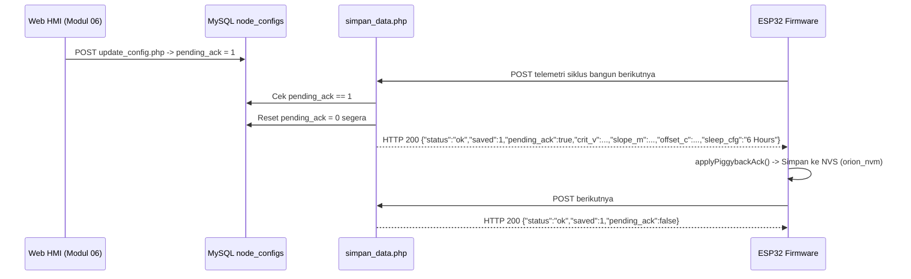

# Endpoint Ingest & Protokol Piggyback ACK (`simpan_data.php`)

Endpoint **`POST /dipo_api/simpan_data.php`** ([simpan_data.php](file:///d:/magang/v1/pixel-twin-workbench/backend/dipo_api/simpan_data.php)) melayani pengiriman telemetri langsung setiap `5 detik` maupun unggahan massal antrean offline (*Burst Sync*) dari node ESP32.

## 1. Header & Validasi Akses Request

| Header / Parameter | Wajib | Aturan Validasi |
| :--- | :--- | :--- |
| `Content-Type` | Ya | `application/json` |
| `X-Orion-Node` | Ya | Harus cocok regex `^(MITSUBISHI\|ORION)-[A-Za-z0-9_-]{2,48}$` dan sama persis dengan `unit_id` payload (`HTTP 403 NODE_MISMATCH`). |
| `X-Burst-Sync` | Opsional | `"true"` menandakan batch pembuangan Two-Tier RTC/LittleFS Buffer (memicu log `BURST_SYNC` ke `system_events`). |
| `X-Sync-SSID` | Opsional | Nama SSID AP aktif saat pengiriman (disanitasi hingga `32` karakter ASCII aman). |
| `X-Node-Token` | Opsional (Env) | Wajib cocok dengan `NODE_AUTH_TOKEN` (`hash_equals`) jika variabel environment diset di server (`HTTP 401`). |

Endpoint menerima format payload JSON **Single Object** (`{...}`), **JSON Array** (`[{...}, {...}]`), maupun `{ "records": [...] }` dengan batas maksimum `50` rekaman per transaksi.

## 2. Alur Transaksional & State Machine Backend

Di dalam satu transaksi InnoDB yang mengunci baris `vehicles` menggunakan `SELECT ... FOR UPDATE`:

1. **Auto-Provisioning Node Baru**: Bila node yang lolos validasi `X-Orion-Node` belum pernah terdaftar di `vehicles`, backend otomatis menyisipkan baris awal di `vehicles` (`STANDBY`, `UNASSIGNED`) dan `node_configs`, lalu mencatat `NODE_AUTO_DISCOVERED` di `system_events`.
2. **Pengurutan Kronologis & Deduplikasi Idempoten**: Seluruh rekaman dalam batch diurutkan di memori PHP berdasarkan `(boot ASC, seq ASC, ts_epoch ASC)` sebelum disimpan via `INSERT ... ON DUPLICATE KEY UPDATE` ke `telemetry_logs`.
3. **Evaluasi Transisi Pergerakan Lintas-Batch**: Membandingkan `net_zone` terhadap pendahulu terdekat (`predecessor`) dan, apabila batch menyisipkan paket historis yang datang terlambat, menghitung ulang penerus langsung (`LIMIT 1 immediate successor`) agar riwayat keluar-masuk tetap akurat tanpa event usang.
4. **Pembaruan Status Monotonik & Perlindungan Dispatch**: Status live pada `vehicles` hanya diperbarui bila rekaman lebih baru (`boot`, `seq`, `ts_epoch`). Apabila sebelumnya operator baru saja mengirim tugas pemanasan (`Warm-Up Dispatched` kurang dari `45` menit) dan kendaraan masih `STANDBY`, label tersebut dipertahankan agar tidak tertimpa paket standby 5 detik.
5. **Pembukaan Tiket Kritis / DTC Otomatis**: Ketika paket baru masuk ke status `CRITICAL` atau membawa DTC aktif (`dtc_cnt > 0` dan `dtc != 'NONE'`), jika belum ada tiket `OPEN`/`IN_PROGRESS` pada unit tersebut, sistem membuka atau membuka kembali tiket di `maintenance_tickets` serta mencatat satu log `CRITICAL` (`DTC_ALERT` / `CRITICAL_BATTERY`).

## 3. Sekuens Piggyback ACK Satu-Kali

ESP32 tidak memerlukan endpoint polling tambahan untuk menerima perubahan konfigurasi dari web HMI. Konfigurasi dikirim menumpang respons HTTP `200` `simpan_data.php`:

Respons dienkode kompak tanpa spasi setelah tanda titik dua agar parser `String::indexOf("\"pending_ack\":true")` di ESP32 bekerja deterministik.
