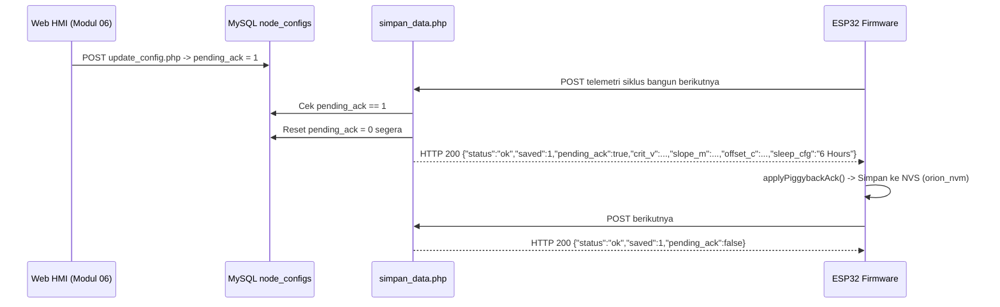

# Endpoint Ingest & Protokol Piggyback ACK (`simpan_data.php`)

Seluruh node ESP32 mengirim datanya ke satu alamat yaitu `POST /dipo_api/simpan_data.php` ([simpan_data.php](file:///d:/magang/v1/pixel-twin-workbench/backend/dipo_api/simpan_data.php)). Endpoint ini melayani pengiriman rutin tiap siklus maupun pengurasan antrean luring (*Burst Sync*).

## 1. Header & Bentuk Payload JSON yang Diterima

| Header HTTP | Sifat | Aturan Pemeriksaan Server |
| :--- | :--- | :--- |
| `Content-Type` | Wajib | Harus bernilai `application/json`. |
| `X-Orion-Node` | Wajib | Wajib cocok dengan pola `^(MITSUBISHI\|ORION)-[A-Za-z0-9_-]{2,48}$` dan sama persis dengan `unit_id` di isi JSON (jika beda, ditolak dengan `HTTP 403 NODE_MISMATCH`). |
| `X-Burst-Sync` | Opsional | Bila bernilai `"true"`, server menandai kiriman ini sebagai pengurasan buffer RTC/LittleFS dan menulis jejak `BURST_SYNC` ke `system_events`. |
| `X-Sync-SSID` | Opsional | Nama SSID AP yang dipakai node saat mengirim (dibersihkan hingga maksimal `32` karakter ASCII aman). |
| `X-Node-Token` | Opsional (Env) | Bila variabel `NODE_AUTH_TOKEN` diaktifkan pada server, header harus cocok via `hash_equals` atau permintaan ditolak `HTTP 401`. |

Format isi JSON bersifat ganda (*dual-format*): skrip menerima satu objek JSON tunggal (`{...}`) untuk siklus biasa maupun array JSON (`[{...}, {...}]` atau `{"records": [...]}`) sampai batas `50` rekaman per transaksi.

## 2. Langkah Kerja di Dalam Transaksi `simpan_data.php`

Bayangkan skenario ketika mobil baru pulang dari uji jalan membawa `15` rekaman luring sekaligus ke AP Gudang. Agar status mobil tetap akurat tanpa menimpa kondisi terbaru, `simpan_data.php` mengunci baris kendaraan lewat `SELECT ... FOR UPDATE` dalam satu transaksi InnoDB lalu menjalankan lima langkah berurutan:

1. **Mendaftarkan Unit Baru Secara Otomatis**: jika `unit_id` lolos validasi `X-Orion-Node` tetapi belum terdaftar di tabel `vehicles`, PHP otomatis menyisipkan baris awal (`STANDBY`, bay `UNASSIGNED`) dan setelan standar di `node_configs`, lalu mencatat `NODE_AUTO_DISCOVERED`.
2. **Mengurutkan Kronologi & Menolak Duplikat**: PHP menyusun seluruh rekaman masuk dari yang paling lama hingga paling baru memakai kunci `(boot ASC, seq ASC, ts_epoch ASC)`. Rekaman lalu dimasukkan ke `telemetry_logs` memakai `INSERT ... ON DUPLICATE KEY UPDATE` sehingga pengiriman ulang paket yang sama tidak menciptakan baris ganda.
3. **Mendeteksi Perpindahan Keluar-Masuk Secara Akurat**: sistem membandingkan `net_zone` setiap rekaman terhadap pendahulu terdekat di database. Apabila paket historis datang belakangan (menyisip di tengah lini masa), backend juga mengevaluasi ulang satu rekaman penerus tepat sesudahnya (`LIMIT 1`) supaya log keluar-masuk tersambung rapi.
4. **Menjaga Status Terbaru & Label Pemanasan**: tabel `vehicles` hanya diperbarui apabila `(boot, seq, ts_epoch)` paket masuk memang lebih baru daripada paket terakhir yang tercatat. Selain itu, jika operator baru saja mengirim teknisi untuk memanaskan mobil (`status_label = 'Warm-Up Dispatched'` berumur di bawah `45` menit) dan mobil masih dalam posisi standby, paket rutin berikutnya sengaja mempertahankan label tersebut agar instruksi kerja tidak langsung terhapus.
5. **Membuka Tiket Perawatan Otomatis Saat Kritis atau Ada DTC**: jika paket terbaru melaporkan status aki `CRITICAL` atau kode gangguan aktif (`dtc_cnt > 0` dan `dtc != 'NONE'`) sementara belum ada tiket terbuka pada mobil tersebut, backend membuka tiket baru di `maintenance_tickets` dan mencatat satu entri `CRITICAL` (`CRITICAL_BATTERY` atau `DTC_ALERT`).

## 3. Cara Kerja Piggyback ACK (Konfigurasi Menumpang Balasan HTTP)

Node ESP32 menghemat daya dengan cara tertidur lama dan tidak pernah membuka koneksi tambahan sekadar bertanya apakah operator mengganti pengaturan di web. Sebagai gantinya, perubahan pengaturan dari HMI Modul 06 dititipkan pada balasan `HTTP 200` saat node mengirim data berikutnya:

Seluruh respons JSON diformat rapat tanpa spasi setelah tanda titik dua (`"pending_ack":true`) agar parser ringan `String::indexOf()` di mikrokontroler ESP32 langsung mengenalinya dengan pasti.
