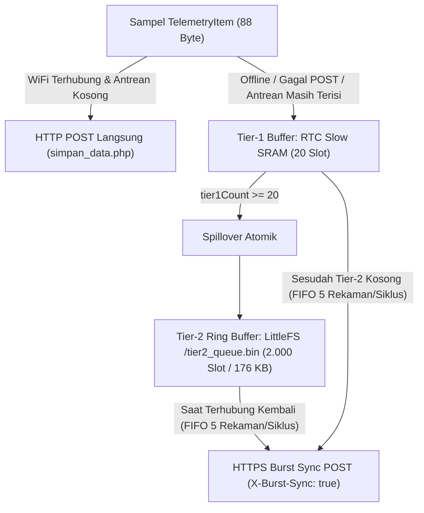

# Arsitektur Buffer Offline Dua Tingkat (2.020 Slot)

Ketika unit kendaraan berada di zona buta Wi-Fi (`OFFLINE`), kegagalan jaringan AP gudang, atau selama uji jalan tanpa hotspot teknisi, ORION memastikan nol data terbuang dengan mekanisme penyangga **Two-Tier Queue** berkapasitas total **2.020 rekaman** (`20` slot RTC Slow SRAM + `2.000` slot Flash LittleFS).

## 1. Struktur Penyimpanan Dua Tingkat

### Karakteristik Tiap Tingkat
1. **Tier-1 (RTC Slow SRAM)**:
   - Array `RTC_DATA_ATTR TelemetryItem tier1RtcBuf[20]` tetap utuh melewati Deep Sleep ESP32 tanpa membebani siklus tulis Flash (*wear-leveling*).
   - Apabila terjadi cabut aki / *cold boot* sebelum spillover, data Tier-1 akan direset, sedangkan data yang sudah masuk Tier-2 Flash tetap selamat.
2. **Tier-2 (LittleFS Ring Buffer Non-Volatile)**:
   - Disimpan dalam file `/tier2_queue.bin` berkapasitas maksimal `2.000` rekaman (`2000 x 88 byte = 176.000 byte`).
   - Pointer `tier2Head`, `tier2Tail`, `tier2Count`, dan tanda tangan ukuran struct `t2_ssz` disimpan persisten pada NVS (`orion_nvm`).
   - Saat inisialisasi (`initTier2LittleFS()`), jika terdeteksi perbedaan `t2_ssz != 88` atau ukuran file tidak kelipatan `88 byte`, file otomatis di-reset agar tidak terjadi pembacaan korup lintas versi firmware.
   - Jika `2.000` slot penuh, ring buffer otomatis menimpa entri tertua (`tier2Tail = (tier2Tail + 1) % 2000`).

## 2. Protokol Pengurasan Aman TLS (`flushAllOfflineBuffers`)

Untuk menjaga kestabilan heap RAM ESP32 selama negosiasi koneksi `WiFiClientSecure` (TLS ke server produksi) dan mencegah paket terlalu besar ditolak oleh stack lwIP:

- **Ukuran Batch Tetap (`FLUSH_BATCH_SIZE = 5`)**: maksimal `5` rekaman (`~3.1 KB` payload JSON array) dikirim per permintaan HTTPS POST dengan header `X-Burst-Sync: true`.
- **Urutan FIFO Ketat**:
  1. Jika `tier2Count > 0`, firmware membaca `min(tier2Count, 5)` rekaman tertua dari offset `tier2Tail`. Pointer hanya dimajukan (`commitFlushedLittleFSBatch`) bila server mengembalikan kode HTTP `2xx`.
  2. Jika `tier2Count == 0` dan `tier1Count > 0`, firmware mengirim `min(tier1Count, 5)` rekaman terdepan lalu menggeser sisa array menggunakan `memmove()`.
- **Satu Batch per Siklus**: dalam satu siklus 5 detik (`flushAllOfflineBuffers()`), hanya satu batch yang dikirim agar loop utama tidak terkunci (*non-blocking* terhadap perintah serial & scan Wi-Fi latar belakang).
- **Idempotensi Server**: meskipun terjadi putus koneksi setelah server menyimpan data sebelum ESP32 menerima HTTP 200, pengiriman ulang batch yang sama tidak menciptakan baris ganda karena MySQL mengunci `UNIQUE KEY (unit_id, boot, seq)`.
