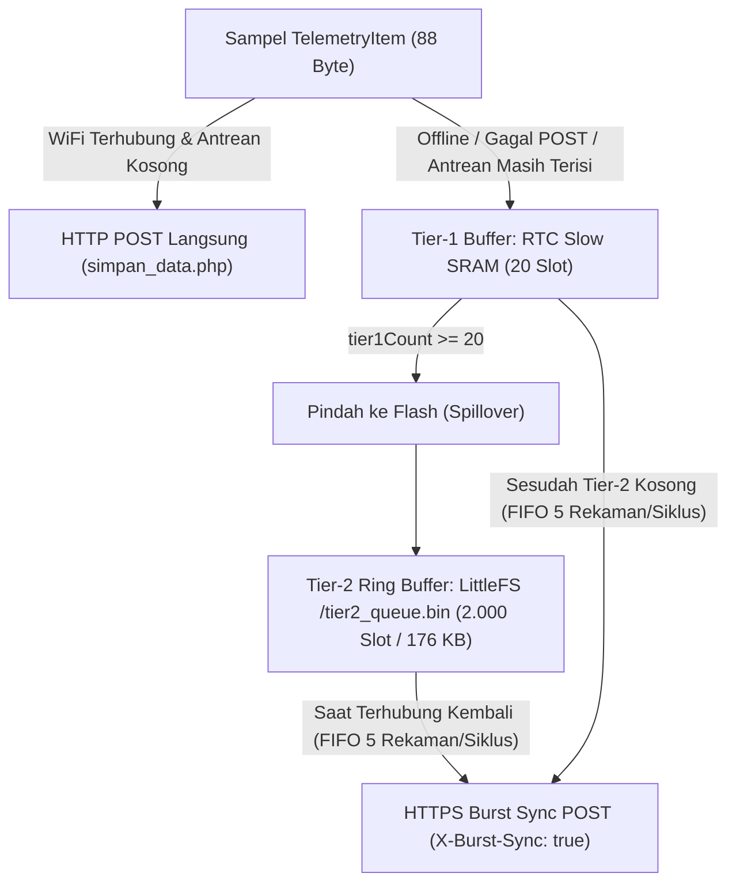

# Arsitektur Buffer Offline Dua Tingkat (2.020 Slot)

Saat mobil keluar area diler untuk uji jalan atau saat listrik router Wi-Fi gudang mati, node ESP32 tetap bekerja tanpa kehilangan riwayat voltase. Firmware menyediakan antrean cadangan dua tingkat (**Two-Tier Queue**) berkapasitas total `2.020` rekaman: `20` slot cepat di RTC Slow SRAM dan `2.000` slot penyimpanan tahan mati di Flash LittleFS.

## 1. Mengapa Memakai Dua Lapis Penyimpanan?

Menulis ke chip Flash setiap beberapa menit sekali selama kendaraan berada di luar jangkauan akan memperpendek usia memori Flash ESP32. Sebagai gantinya, firmware menggabungkan dua lapis memori dengan tugas yang saling melengkapi:

### Tier-1: RTC Slow SRAM (`20` Slot Cepat)

Array `RTC_DATA_ATTR TelemetryItem tier1RtcBuf[20]` disimpan di RAM khusus modul RTC yang tetap beraliran listrik mikro selama ESP32 Deep Sleep. Ketika mobil keluar gerbang dan kehilangan sinyal AP gudang, rekaman ke-1 sampai ke-20 masuk lebih dahulu ke ruang ini tanpa menyentuh chip Flash sama sekali. Catatan batasannya: jika kabel aki dilepas total sebelum antrean melimpah ke Tier-2, isi RAM RTC akan ikut hilang saat daya mati.

### Tier-2: LittleFS Ring Buffer (`2.000` Slot Permanen)

Begitu rekaman ke-21 datang saat Tier-1 sudah terisi `20` item, firmware memindahkan muatan ke berkas `/tier2_queue.bin` berkapasitas `2.000` rekaman (`2.000 x 88 byte = 176.000 byte`). Tiga penunjuk antrean (`tier2Head`, `tier2Tail`, `tier2Count`) serta penanda ukuran struct (`t2_ssz`) disimpan ke memori NVS (`orion_nvm`) agar data tidak hilang walau aki dicabut. Saat boot di `initTier2LittleFS()`, jika firmware mendeteksi ukuran struct `t2_ssz != 88` akibat pembaruan versi, berkas lama otomatis dibersihkan supaya pembacaan biner tidak meleset. Bila penampungan penuh `2.000` baris, mekanisme *ring buffer* akan menimpa baris paling tua secara bergilir.

## 2. Pengurasan Bertahap saat Sinyal Kembali (`flushAllOfflineBuffers`)

Ketika mobil kembali parkir di jangkauan AP gudang, membuang ratusan atau ribuan paket sekaligus dalam satu request HTTP akan menghabiskan heap RAM `WiFiClientSecure` saat negosiasi TLS. Karena itu firmware menyalurkan antrean secara terkendali:

1. Dalam satu siklus kirim 5 detik, `flushAllOfflineBuffers()` hanya mengirim paling banyak `1` batch berisi **5 rekaman** (`~3,1 KB` JSON array) dengan header `X-Burst-Sync: true` supaya loop utama tetap responsif terhadap perintah serial dan pemindaian Wi-Fi.
2. Firmware selalu menguras `Tier-2 (LittleFS)` terlebih dahulu dengan membaca `min(tier2Count, 5)` rekaman paling lama dari offset `tier2Tail`. Penunjuk antrean baru digeser maju oleh `commitFlushedLittleFSBatch()` apabila server benar-benar membalas dengan kode sukses `HTTP 2xx`.
3. Setelah `Tier-2` bersih (`tier2Count == 0`), barulah `Tier-1 (RTC SRAM)` dikuras dari antrean terdepan menggunakan `memmove()`.
4. Bila koneksi terputus tepat setelah server menyimpan data tetapi balasan `HTTP 200` tidak sampai ke ESP32, pengiriman ulang batch yang sama tidak akan memicu data ganda karena tabel MySQL `telemetry_logs` menolak duplikat lewat kunci unik `(unit_id, boot, seq)`.
