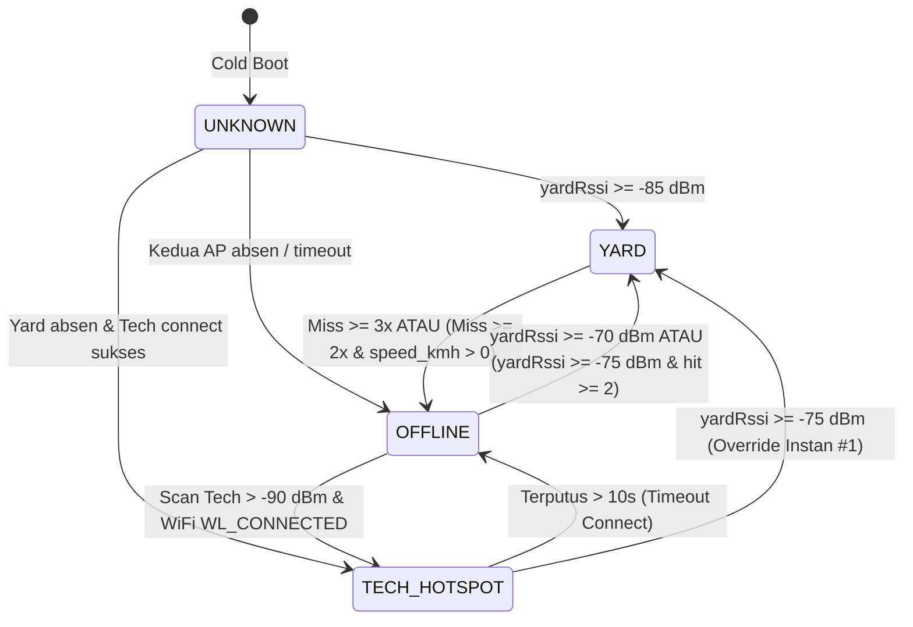

# State Machine 4-Zona Wi-Fi & Sinkronisasi Waktu NTP-RTC

Firmware v1.6.0 mengklasifikasikan lokasi jaringan unit kendaraan ke dalam 4 zona deterministik yang dipertahankan di memori RTC melewati Deep Sleep:

- `NET_ZONE_UNKNOWN (0)`: nilai default sebelum evaluasi pertama / rekaman lama.
- `NET_ZONE_YARD (1)`: terhubung atau mendeteksi SSID Gateway Gudang (`DEFAULT_YARD_SSID`, prioritas #1 mutlak).
- `NET_ZONE_TECH (2)`: unit berada di luar gudang dan terhubung ke Hotspot 2.4 GHz Teknisi (`DEFAULT_TECH_SSID`).
- `NET_ZONE_OFFLINE (3)`: unit di luar gudang tanpa akses hotspot teknisi (merekam ke Two-Tier Buffer).

## 1. Diagram Transisi Zona & Aturan Hysteresis

## 2. Mekanisme Penjagaan Gerbang (*Anti-Flapping* & *Zero-Scan Hold*)

1. **Zero-Scan Yard Hold**: Selama `WiFi.status() == WL_CONNECTED` ke SSID Gudang dengan RSSI `>= -85 dBm` dan `rtcYardMissCount == 0`, pemindaian 14-channel asinkron **dilewati** untuk menjaga keandalan transmisi data dan menghemat daya.
2. **Gate Anti-Flapping (`yardRecoveryCount`)**: Apabila `rtcYardMissCount > 0` dan sinyal gudang kembali terdeteksi, counter `rtcYardMissCount` tidak langsung direset sampai minimal `2` scan berturut-turut menunjukkan sinyal gudang stabil.
3. **Counter Stale Guard (`620 detik`)**: Jika selisih `ts_epoch - rtcFirstMissEpoch > 620 detik` (misalnya sesudah tidur lama), `rtcYardMissCount` di-reset bersih agar sisa kegagalan siklus lampau tidak memicu status keluar gudang palsu pada kendaraan yang diderek dalam keadaan mesin mati.
4. **Prioritas Override Mutlak Gudang**: Saat unit terhubung ke Hotspot Teknisi (`NET_ZONE_TECH`), begitu AP Gudang terdeteksi `>= -75 dBm`, ESP32 melakukan handover agresif (`forceSwitch = true`) langsung memutus hotspot HP teknisi pada hit pertama.
5. **Non-Blocking Scan Window**: Pemindaian latar belakang `WiFi.scanNetworks(true, ...)` hanya dipicu tepat sesudah HTTP POST / enqueue selesai jika jendela ke siklus kirim berikutnya masih `>= 1200 ms`, dan ditahan bila sedang jabat tangan DHCP (`wifiConnState != CONN_IDLE`).

## 3. Pencatatan Exit Lag & Sinkronisasi NTP ke DS3231SN

- **Deferred Exit Lag Calculation (`pendingFirstMissEpoch`)**: Saat debouncing keluar dari `YARD` disahkan, waktu scan gagal pertama (`rtcFirstMissEpoch`) disimpan ke `pendingFirstMissEpoch`. Begitu rekaman pertama di zona luar (`OFFLINE` atau `TECH_HOTSPOT`) dibuat, firmware menghitung lag aktual (dalam satuan `20 detik` / step) dan mengemasnya ke byte `can_ok` sehingga waktu keluar di server (`zone_exit_epoch`) mundur akurat ke momen kendaraan benar-benar meninggalkan area AP gudang.
- **NTP -> RTC Correction (`checkNtpRtcSync`)**: Diinisialisasi lewat SNTP (`pool.ntp.org`, `time.google.com`). Setiap `30 detik` saat Wi-Fi aktif dan waktu NTP valid (`epoch >= 1700000000`), bila penyimpangan jam RTC DS3231SN lebih dari `5 detik`, register RTC ditulis ulang ke waktu UTC akurat.
