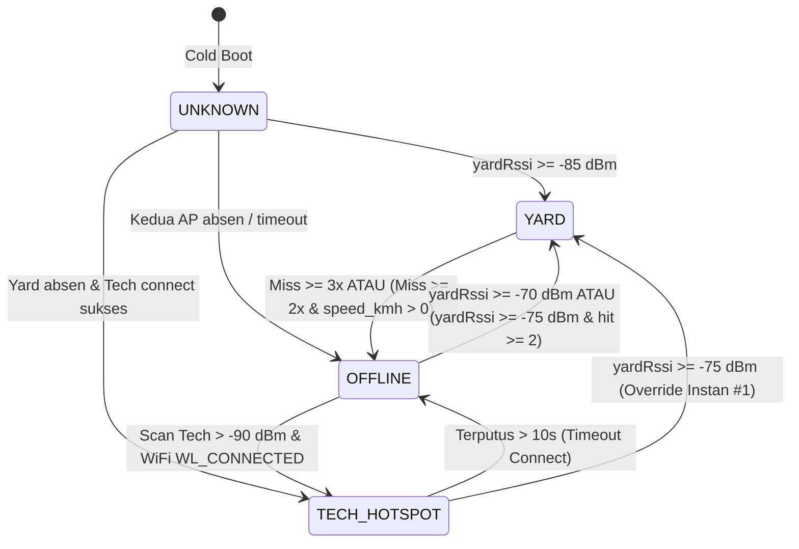

# State Machine 4-Zona Wi-Fi & Sinkronisasi Waktu NTP-RTC

Sinyal Wi-Fi di lapangan parkir stock yard jarang stabil mulus. Truk angkut yang lewat, pintu besi garasi, atau kap mesin yang dibuka sering membuat sinyal AP gudang hilang sesaat lalu muncul lagi beberapa detik kemudian. Firmware v1.6.0 membagi kondisi jaringan menjadi 4 zona pasti agar gangguan sesaat tidak tercatat sebagai kendaraan keluar gudang.

| Kode Zona | Nama Status | Makna di Lapangan |
| :--- | :--- | :--- |
| `0` | `NET_ZONE_UNKNOWN` | Status awal sebelum node selesai memindai jaringan pertama kali. |
| `1` | `NET_ZONE_YARD` | Terhubung atau menangkap sinyal AP Gudang (`DEFAULT_YARD_SSID`, prioritas mutlak). |
| `2` | `NET_ZONE_TECH` | Berada di luar jangkauan AP gudang dan menumpang ke Hotspot 2.4 GHz HP teknisi (`DEFAULT_TECH_SSID`). |
| `3` | `NET_ZONE_OFFLINE` | Berada di luar jangkauan Wi-Fi mana pun; seluruh sampel ditabung ke Two-Tier Buffer. |

## 1. Diagram Perpindahan Zona

## 2. Lima Pengaman agar Deteksi Keluar-Masuk Akurat

### Penahan Scan Saat Sinyal Gudang Sehat (*Zero-Scan Hold*)

Selama `WiFi.status() == WL_CONNECTED` ke SSID Gudang dengan RSSI `>= -85 dBm` dan belum ada hitungan gagal (`rtcYardMissCount == 0`), firmware tidak menjalankan pemindaian 14-channel asinkron. Langkah ini menghemat baterai sekaligus menjaga pengiriman data tidak terpotong oleh proses scan radio.

### Penahan Sinyal Goyang (*Anti-Flapping*)

Apabila sebelumnya terjadi sinyal gagal (`rtcYardMissCount > 0`) lalu sinyal gudang kembali terdeteksi tipis, hitungan gagal tidak langsung dihapus. Firmware menunggu minimal `2 kali` hasil scan berturut-turut menunjukkan sinyal stabil sebelum mereset penanda kegagalan.

### Penghapus Hitungan Kedaluwarsa (`620 Detik`)

Jika jarak waktu `ts_epoch - rtcFirstMissEpoch > 620 detik` (misalnya setelah node bangun dari Deep Sleep panjang), hitungan `rtcYardMissCount` direset otomatis ke `0`. Tujuannya agar sisa kegagalan sinyal beberapa jam lalu tidak bergabung dengan satu kegagalan baru dan membuat sistem mengira mobil meninggalkan gudang.

### Prioritas Mutlak Memindah ke AP Gudang

Saat mobil dipasangi perangkat dan menumpang di hotspot HP teknisi (`NET_ZONE_TECH`) selama uji jalan, begitu ESP32 mendeteksi sinyal AP Gudang di ambang `>= -75 dBm`, firmware langsung memutus koneksi hotspot teknisi dan memaksa pindah ke AP Gudang (`forceSwitch = true`) pada deteksi pertama.

### Jadwal Pemindaian Non-Blocking

Pemindaian latar belakang `WiFi.scanNetworks(true, ...)` hanya boleh berjalan setelah pengiriman HTTP POST atau antrean selesai jika masih ada sisa jeda minimal `1.200 ms` ke siklus berikutnya, dan ditunda selama proses jabat tangan DHCP sedang berlangsung (`wifiConnState != CONN_IDLE`).

## 3. Mencatat Momen Keluar Sebenarnya & Koreksi Jam RTC

Agar jam keluar gudang di laporan sesuai dengan momen nyata mobil melintasi gerbang dan bukan 10-15 detik kemudian setelah 3 kali retry, firmware menyimpan stempel waktu kegagalan scan pertama ke `rtcFirstMissEpoch` lalu meneruskannya ke `pendingFirstMissEpoch` saat status resmi pindah ke luar gudang. Begitu rekaman pertama di zona luar dibuat, selisih waktu itu dibagi `20 detik/step` dan disisipkan ke byte `can_ok` sehingga server bisa memundurkan `zone_exit_epoch` ke detik awal sinyal benar-benar hilang.

Sementara itu, fungsi `checkNtpRtcSync()` memeriksa waktu UTC lewat SNTP (`pool.ntp.org`, `time.google.com`) setiap `30 detik` saat Wi-Fi menyala. Begitu mendapat waktu valid (`epoch >= 1700000000`) dan jam chip `DS3231SN` terpantau selisih lebih dari `5 detik`, ESP32 segera menulis ulang register jam RTC agar seluruh rekaman offline berikutnya memakai waktu yang tepat.
