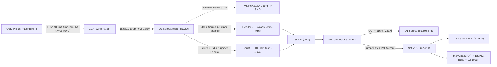
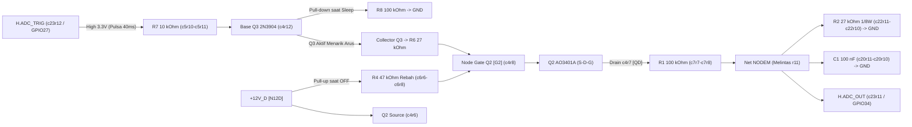
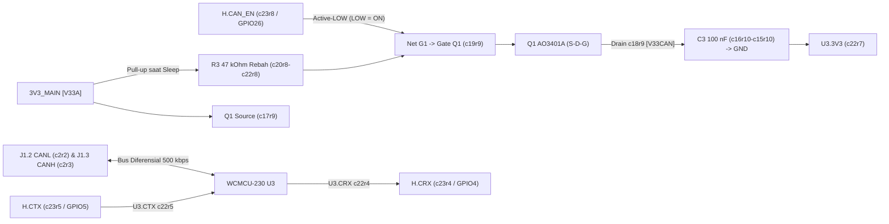
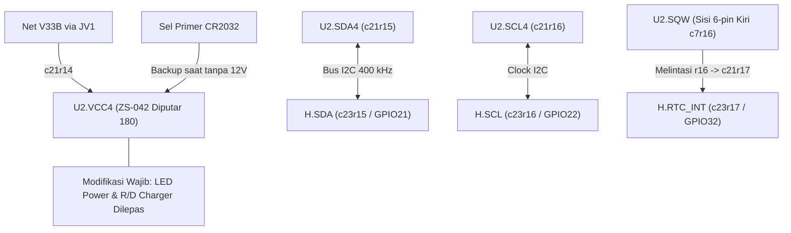

# Alur Kelistrikan & Sirkuit PCB ORION v2.0 (Step 2.1)

Halaman ini menelusuri perjalanan arus daya, sinyal kendali logika, jalur diferensial CAN, dan aliran ground balik di atas papan **PCB ORION v2.0 Step 2.1 (`70 x 50 mm`)**. Titik koordinat lubang masing-masing komponen tersedia pada [Peta Alur PCB v2.0 Step 2.1](pcb-v2-blueprint-layout.md).

## 1. Suplai Daya Utama, Proteksi Polaritas & Shunt Bypass

Sumber daya 12V masuk dari pin 16 port OBD-II melewati sekring harness menuju konektor `J1.4`.

Selama inti tembaga kabel pita `W9` belum diukur, gunakan sekring eksternal **500 mA time-lag**; naikkan ke `1 A` hanya setelah konduktor terukur minimal `26 AWG (0,40 mm)`. Setelah melewati sekring, arus menemui dioda Schottky `D1 (1N5819)` yang menahan arus balik bila kabel aki sempat tertukar sekaligus menyumbang jatuh tegangan rendah sekitar `0,2-0,35 V`. Dioda `TVS P6KE18A` di `c3r15-c3r16` bersifat opsional untuk meredam lonjakan tegangan otomotif langsung ke ground.

Dari katoda `D1`, arus melewati cabang paralel antara jumper bypass `JP (c7r5-c7r6)` dan resistor shunt `R5 (10 Ohm)`. Pada pemakaian harian di mobil, pasang jumper `JP` agar regulator `MP1584` mendapat suplai tanpa hambatan tambahan. Ketika teknisi hendak mengaudit arus tidur perangkat (`gerbang E5`), lepas jumper `JP` supaya seluruh arus mengalir melewati `R5` (atau miliamperemeter seri) dan terbaca akurat.

Regulator `MP1584` menurunkan tegangan menjadi `3,3 V` konstan pada rel `V33A`, lalu menyeberang ke sisi kanan melalui kawat jumper atas `JV1` menuju modul `ZS-042` dan pin `H.3V3` ESP32 Base. Kapasitor bulk `C2 (100 uF)` disolder di pin `V/G` pada ESP32 Base untuk menyangga lonjakan arus saat pemancar Wi-Fi aktif.

---

## 2. Sakelar High-Side ADC & Pembagi Tegangan Aki

Rangkaian pembagi resistor yang terus tersambung ke aki akan menguras baterai perlahan selama berbulan-bulan. ORION memasang sakelar dua tahap (`Q3 2N3904` + `Q2 AO3401A`) supaya pembagi `100 kOhm / 27 kOhm` hanya menyala selama `40 ms` setiap kali ESP32 mengambil sampel.

### Mengapa `R1` Diletakkan di Kiri Sedangkan `R2 + C1` di Kanan?

Pada papan Step 2.1, resistor atas `R1 (100 kOhm)` menempel dekat drain `Q2` di sisi kiri (`c7r7-c7r8`), sementara resistor bawah `R2 (27 kOhm 1/8 W)` dan kapasitor `C1 (100 nF)` ditempatkan di sisi kanan tepat di depan pin `H.ADC_OUT (c23r11)`. Pemisahan ini membuat kapasitor filter `C1` dan jalur return `GND3 (c23r10)` berada sedekat mungkin dengan pin analog ESP32 untuk meredam gangguan frekuensi tinggi yang mungkin tertangkap kawat panjang saat melintasi bawah modul RTC `ZS-042`.

### Perhitungan Batas Aman Tegangan Gate $V_{GS}$ pada `Q2`

MOSFET `AO3401A` memiliki batas toleransi maksimal $V_{GS(\max)} = \pm 12\text{ V}$. Bila collector `Q3` langsung menempel ke ground tanpa resistor pembatas `R6 (27 kOhm)`, maka ketika mesin menyala dan alternator mengisi pada `14,4 V`, tegangan gate-ke-source $V_{GS}$ bisa menembus `-14,1 V` dan merusak komponen. Gabungan pembagi `R4 (47 kOhm)` dan `R6 (27 kOhm)` menahan $V_{GS}$ dalam zona aman saat `GPIO 27` aktif:

$$V_G \approx V_{\text{N12D}} \times \frac{R_6}{R_4 + R_6} = V_{\text{N12D}} \times \frac{27}{47 + 27} \approx 0{,}3649 \times V_{\text{N12D}}$$

$$V_{GS} = V_G - V_{\text{N12D}} = -V_{\text{N12D}} \times \frac{47}{74} \approx -0{,}6351 \times V_{\text{N12D}}$$

| Kondisi Tegangan Aki | Tegangan `N12D` (Setelah `D1`) | Tegangan Node Gate (`V_G`) | Tegangan $V_{GS}$ di `Q2` | Status Keamanan `AO3401A` |
| :--- | :--- | :--- | :--- | :--- |
| Aki Standar (`11,9 V - 12,1 V`) | `~ 11,9 V` | `~ 4,34 V` | `~ -7,56 V` | Aman (`< 12 V`), `Q2` menyambung penuh |
| Mesin ON / Alternator (`14,4 V`) | `~ 14,15 V` | `~ 5,16 V` | `~ -8,99 V` | Aman di bawah batas mutlak `-12 V` |
| Deep Sleep (`GPIO27` = `LOW` / `Hi-Z`) | `11,9 V - 14,2 V` | ditarik `R4` menyamai `V_N12D` | `0,00 V` | `Q2` menutup total (`Node M = 0,00 V`) |

---

## 3. Power Gate Transceiver CAN (`Q1`) & Bus Diferensial

Transceiver `SN65HVD230` pada modul `WCMCU-230` (`U3`) menyala hanya beberapa puluh milidetik ketika ESP32 siap melakukan uji loopback atau membaca frame ECU 500 kbps.

Ketika `GPIO26` berada pada logika `HIGH` atau mengambang saat ESP32 tidur, `R3 (47 kOhm)` menarik gate `Q1` menyamai sumber `3,3 V` sehingga catu daya `V33CAN` ke transceiver terputus ke `0,00 V`. Karena pin `CANL` dan `CANH` pada konektor `J1` ditukar posisinya mengikuti orientasi `WCMCU-230` yang diputar `180 derajat`, kedua kawat sinyal melintas sejajar lurus di bawah modul `MP1584` menuju soket `U3` tanpa persilangan jalur.

---

## 4. Pewaktuan RTC `DS3231SN` (`ZS-042`) & Interupsi Bangun `SQW`

Dari enam lubang soket di sisi kiri (`c7`), hanya `U2.SQW` (`c7r16`) yang dihubungkan ke jalur listrik, sedangkan lima lubang lain (`c7r12..c7r15` dan `c7r17`) disolder sebagai penopang fisik soket `8,5 mm`. Saat alarm bangun tiba, `DS3231SN` menarik pin `SQW` ke `LOW` sehingga memicu bangun `ext0` di `GPIO32`. Sebelum modul `ZS-042` ditancapkan, LED daya dan dioda/resistor pengisi baterai wajib dilepas supaya arus `3,3 V` tidak membebani baterai kancing non-isi ulang `CR2032` dan tidak menambah arus bocor saat Deep Sleep.

---

## 5. Distribusi Ground Cincin (*Ring GND*)

Seluruh jalur ground kembali dirangkai membentuk cincin luar di tepi papan untuk mencegah gangguan tegangan balik antara lonjakan arus Wi-Fi (`300-400 mA`) dan pengukuran sensitif pin ADC. Ketiga pin ground header ESP32 (`H.GND1`, `H.GND3`, dan `H.GND2`) masuk ke tulang punggung `c24`, mengalir ke utara menyusuri busbar tembaga tebal `r1` (`22 AWG`), lalu keluar melalui `J1.1 (c2r1)` ke sasis kendaraan. Pin ground `MP1584` (`c8r2`, `c16r2`) menempel pendek langsung ke `r1`, sementara ground sisi kiri mikroarus (`Q3.E`, `R8.b`, `TVS.A`) dikumpulkan di riser `c2` dan dibawa menyusuri busbar bawah `r18` (`24 AWG`) menuju cincin `c24`.
