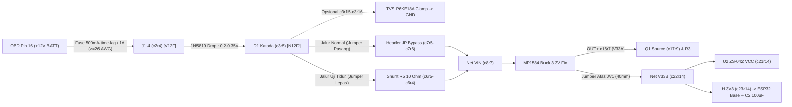
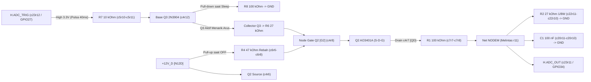
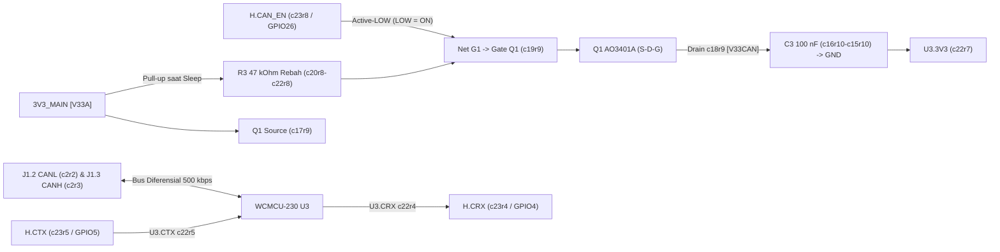
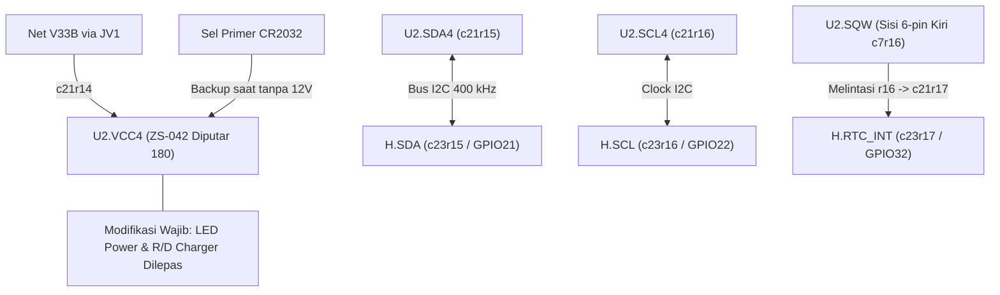

# Alur Kelistrikan & Sirkuit PCB ORION v2.0 (Step 2.1)

Halaman ini memetakan aliran arus searah, sinyal logika kontrol, bus diferensial CAN, serta jalur ground balik di atas papan **PCB ORION v2.0 Step 2.1 (`70 x 50 mm`)**. Rincian lubang penancapan masing-masing komponen tersedia pada halaman [Peta Alur PCB v2.0 Step 2.1](pcb-v2-blueprint-layout.md).

## 1. Blok 1: Suplai Daya Utama, Proteksi Polaritas & Shunt Bypass

Arus masuk berasal dari pin 16 port OBD-II melewati sekring pengaman di harness sebelum memasuki konektor `J1.4`.

- **Sekring & Kabel Pita**: gunakan sekring **500 mA time-lag** sebagai batas aman awal sampai diameter inti kawat pita `W9` terukur `>= 26 AWG (+/- 0,40 mm)`; bila terbukti `>= 26 AWG`, sekring boleh dinaikkan menjadi `1 A`.
- **Proteksi Polaritas (`D1 1N5819`) & Surja (`TVS P6KE18A`)**: `1N5819` memblokir pemasangan aki terbalik dengan jatuh tegangan maju kecil (`0,2-0,35 V`) sehingga `MP1584` terlindungi bahkan saat uji bangku. `TVS P6KE18A` di `c3r15-c3r16` bersifat opsional untuk menjepit lonjakan transien otomotif langsung ke `GND`.
- **Pengukuran Arus Tidur (`R5 10 Ohm || JP`)**: selama beroperasi di kendaraan, jumper `JP` wajib terpasang agar arus mengalir melewati hambatan nol. Untuk mengukur arus tidur (`E5`), buka jumper `JP` sehingga arus mengalir lewat `R5 (10 Ohm)` atau hubungkan miliamperemeter seri melintasi pin `JP`.
- **Suplai `3.3 V` ke RTC dan ESP32 (`JV1` & `C2`)**: keluaran teratur `MP1584` (`V33A`) melewati kawat atas tunggal `JV1` (`c16r8 -> c22r14`) untuk memberi daya modul `ZS-042` (`c21r14`) serta pin `H.3V3` (`c23r14`). Kapasitor bulk `C2 (100 uF)` dipasang di luar papan pada pin `V/G` ESP32 Base untuk meredam puncak arus TX Wi-Fi.

---

## 2. Blok 2: Sakelar High-Side ADC & Pembagi Tegangan Aki

Untuk menjaga arus tidur sistem tetap di bawah `500 uA`, pembagi resistor `100 kOhm / 27 kOhm` diputus dari aki `+12V_D` oleh P-MOSFET `Q2 (AO3401A)` setiap kali ESP32 tidak sedang menyampel tegangan.

### Analisis Aman Tegangan Gate $V_{GS}$ pada `Q2 (AO3401A)`

P-MOSFET `AO3401A` memiliki batas mutlak maksimum $V_{GS(\max)} = \pm 12\text{ V}$. Apabila collector `Q3` menarik gate `Q2` langsung ke `GND`, maka pada tegangan pengisian alternator `14,4 V` nilai $V_{GS}$ menjadi `-14,1 V` dan merusak lapisan oksida gate MOSFET. Pembagi `R4 (47 kOhm)` dan `R6 (27 kOhm)` membatasi ayunan tegangan gate secara presisi saat `GPIO 27` bernilai `HIGH`:

$$V_G \approx V_{\text{N12D}} \times \frac{R_6}{R_4 + R_6} = V_{\text{N12D}} \times \frac{27}{47 + 27} \approx 0{,}3649 \times V_{\text{N12D}}$$

$$V_{GS} = V_G - V_{\text{N12D}} = -V_{\text{N12D}} \times \frac{47}{74} \approx -0{,}6351 \times V_{\text{N12D}}$$

| Kondisi Tegangan Aki | Tegangan `N12D` (Setelah `D1`) | Tegangan Node Gate (`V_G`) | Tegangan $V_{GS}$ di `Q2` | Status Keamanan `AO3401A` |
| :--- | :--- | :--- | :--- | :--- |
| Aki Standar (`11,9 V - 12,1 V`) | `~ 11,9 V` | `~ 4,34 V` | `~ -7,56 V` | Aman (`< 12 V`), `Q2` jenuh penuh |
| Mesin ON / Alternator (`14,4 V`) | `~ 14,15 V` | `~ 5,16 V` | `~ -8,99 V` | Aman jauh di bawah batas `-12 V` |
| Deep Sleep (`GPIO27` = `LOW` / `Hi-Z`) | `11,9 V - 14,2 V` | ditarik `R4` = `V_N12D` | `0,00 V` | `Q2` memutus penuh (`Node M = 0,00 V`) |

---

## 3. Blok 3: Power Gate Transceiver CAN (`Q1`) & Bus Diferensial

Transceiver `SN65HVD230` (`WCMCU-230` pada soket `U3`) hanya dinyalakan sesaat ketika ESP32 siap melakukan loopback atau membaca frame ECU ISO 15765-4.

- Saat `GPIO26 = HIGH` atau ESP32 tertidur (`Hi-Z`), `R3 (47 kOhm)` menarik gate `Q1` menyamai sumber `3,3 V` sehingga `V33CAN` turun menjadi `0,00 V`.
- Karena pin input `CANL` dan `CANH` di `J1` telah ditukar pada **Step 2.1**, kedua jalur dari `J1` melintas lurus sejajar di bawah `MP1584` menuju soket `U3` (yang diputar `180 derajat`) tanpa satu pun persilangan solder.

---

## 4. Blok 4: Pewaktuan RTC `DS3231SN` (`ZS-042`) & Jalur Interupsi Bangun

- Hanya 1 pin pada blok kiri `6-pin` (`U2.SQW` di `c7r16`) yang dihubungkan ke jalur sinyal; 5 lubang sisanya (`c7r12..c7r15` dan `c7r17`) disolder sebagai **pad mati** untuk kekakuan mekanis soket `8,5 mm`.
- Sinyal `SQW` ditarik ke `LOW` oleh alarm `A1` `DS3231SN` ketika waktu `sleep_cfg` tercapai, membangunkan `ESP32` lewat `ext0` wake-up pada `GPIO32`.
- Pelepasan LED indikator dan rangkaian pengisi (`dioda + resistor`) dari PCB `ZS-042` mencegah pengisian balik berbahaya ke sel litium primer `CR2032` serta menekan kebocoran arus stasioner.

---

## 5. Blok 5: Topologi Distribusi Ground Cincin (*Ring GND*)

Seluruh jalur ground kembali dirangkai membentuk cincin luar papan guna menekan jatuh tegangan (`ground bounce`) antara beban RF ESP32 (`300-400 mA` saat TX Wi-Fi) dan pengukuran analog ADC:

1. **Kolektor Arus Utama (`22 AWG` polos/tinned)**: ketiga pin ground header ESP32 (`H.GND1 c23r6`, `H.GND3 c23r10`, `H.GND2 c23r13`) masuk ke tulang punggung kolom `c24`, bergerak ke utara menyusuri busbar utama baris `r1`, dan keluar langsung melalui konektor `J1.1 (c2r1)` ke sasis kendaraan.
2. **Ground Regulator & Transceiver (`24 AWG` / `30 AWG`)**: `U4.IN- (c8r2)` dan `U4.OUT- (c16r2)` langsung menempel pendek ke busbar atas `r1`; `U3.GND (c22r6)`, `C1.b (c20r10)`, `U2.GND4 (c21r13)` masing-masing langsung tersambung pendek ke kolom `c24`.
3. **Ground Sisi Kiri / Mikroarus (`24 AWG`)**: kaki emitter `Q3.E (c4r13)`, `R8.b (c5r13)`, dan `TVS.A (c3r16)` bergabung di riser kiri `c2` lalu mengalir melalui busbar bawah `r18` menuju cincin `c24` dan `J1.1`.
