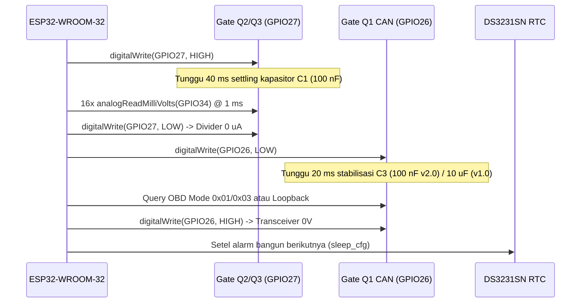

# Manajemen Daya, Pulsa Sampling 40ms & Deep Sleep

Kendaraan di *stock yard* dapat terparkir berminggu-minggu sebelum serah terima ke pelanggan. Rancangan kelistrikan ORION meminimalkan konsumsi arus diam (*parasitic quiescent draw*) agar perangkat tidak menjadi sumber habisnya daya aki.

## 1. Siklus Akuisisi Daya Terkunci (*Duty-Cycled Sampling*)

Setiap bangun atau siklus polling (`sampleBatteryAndCan()` di [sketch_oct16aa.ino](file:///d:/magang/v1/pixel-twin-workbench/firmware/sketch_oct16aa/sketch_oct16aa.ino)):

### Detail Pengukuran ADC

1. `digitalWrite(PIN_GATE_ADC, HIGH)` memicu basis `Q3 (2N3904)` yang menarik gate `Q2 (AO3401A)` melalui pembagi `R4/R6` selama `40 ms` agar kapasitor peredam riak `C1 (100 nF)` di `c20r10-c20r11` terisi penuh dan stabil.
2. Firmware melakukan **16 sampel berurutan** pada `PIN_ADC_BAT` (`GPIO 34`) dengan jeda `1 ms` per sampel lalu mengambil nilai rata-rata integer (`rawMv`).
3. Segera setelah akuisisi selesai (`total jendela aktif ~56 ms`), `GPIO 27` dikembalikan ke `LOW`. Resistor `R8 (100 kOhm)` memastikan basis `Q3` mati dan `R4 (47 kOhm)` menutup `Q2` sehingga arus pembagi `R1/R2` kembali `0 uA`.
4. Tegangan baterai dihitung dengan rumus $V_{\text{bat}} = (\text{rawMv} \times \text{cal\_slope}) + \text{cal\_offset}$. Jika `V_bat >= 13.20 V`, sistem mendeteksi pengisian alternator aktif (`engine_on = 1`).

## 2. Profil Arus Tidur, Pengukuran Shunt `R5` & Modifikasi `ZS-042`

| Fase Operasi | Nilai Tipikal | Keterangan |
| :--- | :--- | :--- |
| **Arus Tidur Node (Shunt `R5`)** | Target desain `< 500 uA` (v1.0 terukur `380 - 410 uA`; **gerbang E5 v2.0 wajib diukur**) | Diukur setelah membuka jumper bypass `JP (c7r5-c7r6)` sehingga arus mengalir melewati resistor `R5 10 Ohm (c6r5-c6r4)` atau ammeter seri. Nilai `>= 600 uA` menandakan kebocoran arus (*parasitic drain*). |
| **Konsumsi Siklus Aktif** | `4.82 mAh / hari` (mode `6 Hours`), `active_ms ~ 1840 ms` | Radio Wi-Fi dimatikan selama Deep Sleep; Wi-Fi modem sleep dinonaktifkan (`WiFi.setSleep(false)`) hanya selama fase bangun singkat agar handshake TLS selesai cepat. |
| **Interval Bangun (`sleep_cfg`)** | `300s` (5 Menit) s/d `21600s` (6 Jam) | Dapat diubah dari HMI Modul 06 dan disinkronkan ke NVS ESP32 saat siklus kirim berikutnya melalui **Piggyback ACK**. |

:::warning Modifikasi Wajib `ZS-042` Pra-Integrasi (Tahap C)
Sebelum modul RTC `ZS-042` dipasang ke soket PCB v2.0, lepas LED indikator daya (`POWER LED`) serta rangkaian pengisi baterai (dioda `1N4148`/resistor `200 Ohm`). Membiarkan sirkuit pengisi tersambung saat `VCC` disuplai `3,3 V` akan memaksa arus pengisian masuk ke sel primer non-rechargeable `CR2032` dan menambah arus parasit diam.
:::
