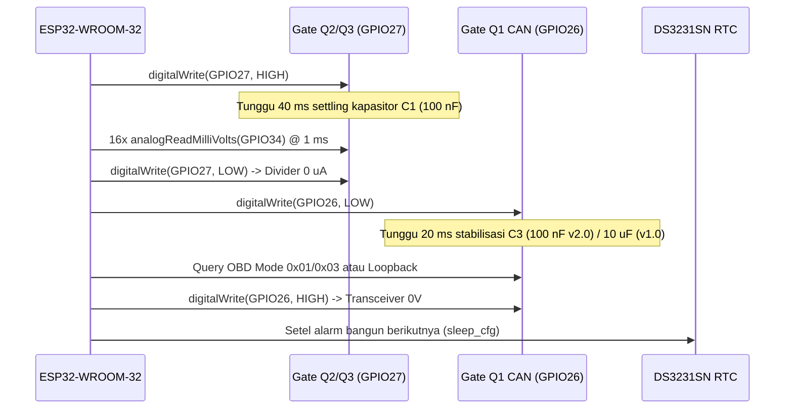

# Manajemen Daya, Pulsa Sampling 40ms & Deep Sleep

Mobil di lapangan parkir diler (*stock yard*) bisa menunggu berbulan-bulan sebelum dikirim ke pembeli. Jika node OBD-II menyedot arus puluhan miliampere tanpa henti, aki kendaraan baru akan habis dalam hitungan minggu.

## 1. Perbandingan Nyata: ORION vs OBD Dongle Biasa (Parkir 60 Hari)

Bayangkan satu unit Pajero Sport dengan aki sehat berkapasitas `65 Ah` diparkir selama `60 hari` (`1.440 jam`) tanpa dinyalakan.

Jika dipasangi **OBD dongle konvensional** yang terus menyala pada arus sekitar `40 mA`, beban diamnya memakan $40\text{ mA} \times 1.440\text{ jam} = 57.600\text{ mAh}$ atau `57,6 Ah`. Dalam tiga sampai empat minggu saja, kapasitas aki praktis habis dan mobil gagal distarter.

Sebaliknya, **node ORION** pada mode bangun tiap `6 Hours` (arus tidur `~410 uA`, aktif singkat `~1,84 detik`) hanya menghabiskan $0{,}41\text{ mA} \times 1.440\text{ jam} \approx 0{,}59\text{ Ah}$ selama tidur ditambah energi bangun Wi-Fi sebesar $4{,}82\text{ mAh/hari} \times 60\text{ hari} \approx 0{,}29\text{ Ah}$. Total energi yang terpakai selama 60 hari penuh hanya sekitar **`0,88 Ah`**, atau kurang dari `1,5%` kapasitas aki `65 Ah`.

## 2. Siklus Pengambilan Data Berjeda (*Duty-Cycled Sampling*)

Setiap bangun dari Deep Sleep, fungsi `sampleBatteryAndCan()` di [sketch_oct16aa.ino](file:///d:/magang/v1/pixel-twin-workbench/firmware/sketch_oct16aa/sketch_oct16aa.ino) hanya menyalakan bagian pembagi tegangan dan transceiver CAN dalam hitungan milidetik:

Pertama, ESP32 mengangkat `GPIO 27` ke `HIGH` sehingga `Q3` dan `Q2` menyambungkan `+12V_D` ke pembagi resistor. Firmware menunggu `40 ms` agar kapasitor `C1 (100 nF)` terisi penuh dan tegangannya stabil, lalu membaca `PIN_ADC_BAT (GPIO 34)` sebanyak `16 kali` berurutan tiap `1 ms` dan mengambil rata-ratanya (`rawMv`). Tepat setelah itu (`total ~56 ms`), `GPIO 27` diturunkan kembali ke `LOW` sehingga `R8` dan `R4` menutup gerbang pembagi menjadi `0 uA`. Bila hasil konversi $V_{\text{bat}} \ge 13.20\text{ V}$, firmware langsung mengenali alternator sedang mengisi (`engine_on = 1`).

## 3. Cara Mengukur Arus Tidur lewat Shunt `R5` & Modifikasi `ZS-042`

| Parameter Operasi | Nilai Acuan Desain | Penjelasan Pemeriksaan di Meja Kerja |
| :--- | :--- | :--- |
| Arus Tidur Node (`shunt_sleep_ua`) | Target `< 500 uA` (prototipe v1.0 terukur `380 - 410 uA`; **gerbang E5 v2.0 wajib diukur**) | Cabut jumper bypass `JP (c7r5-c7r6)` dan pasang miliamperemeter seri (atau ukur tegangan jatuh melintasi resistor shunt `R5 10 Ohm` di `c6r5-c6r4`). Angka `>= 600 uA` menandakan kebocoran komponen. |
| Konsumsi Siklus Aktif | `4,82 mAh/hari` pada mode `6 Hours` (`active_ms ~ 1.840 ms`) | Wi-Fi modem-sleep dimatikan sementara selama jendela kirim singkat (`WiFi.setSleep(false)`) agar negosiasi HTTPS selesai cepat lalu langsung kembali tidur. |
| Interval Bangun (`sleep_cfg`) | `300 detik` (5 Menit) s/d `21.600 detik` (6 Jam) | Dapat diubah dari HMI Modul 06 dan diteruskan ke NVS ESP32 saat pengiriman data berikutnya lewat **Piggyback ACK**. |

:::warning Modifikasi Wajib `ZS-042` Sebelum Dipasang (Tahap C)
Sebelum menancapkan modul `ZS-042` ke soket PCB v2.0, cabut atau putus LED indikator daya (`POWER LED`) beserta rangkaian pengisi baterai (dioda `1N4148` atau resistor `200 Ohm`). Membiarkan jalur pengisi tetap utuh saat pin `VCC` menerima `3,3 V` akan memaksa arus masuk terus-menerus ke baterai koin primer `CR2032` dan menaikkan arus tidur papan.
:::
