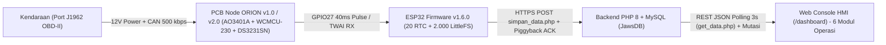

# ORION Telemetry & Digital Twin Workbench

ORION (*Onboard Reporting for Inventory & Operational Notifications*) memantau kesehatan aki 12V, membaca data diagnostik ECU via port OBD-II tanpa menulis ke memori mobil (*read-only*), menjadwalkan pemanasan mesin 10 menit, dan mencatat keluar-masuk kendaraan di area parkir gudang (*stock yard*).

Satu unit alat ORION terpasang non-invasif di soket OBD-II setiap kendaraan stok. Selama kendaraan terparkir berbulan-bulan, modul ESP32 tertidur lelap dengan arus diam di bawah `500 uA`, lalu bangun sejenak setiap siklus (`5 menit` hingga `6 jam`) untuk mengukur voltase aki, memeriksa bus CAN, dan melapor ke server melalui Wi-Fi gudang.

## Arsitektur Sistem dari Kendaraan hingga Layar Operator

## Pembagian Tugas Empat Lapisan Sistem

| Lapisan | Perangkat & Teknologi | Tugas Utama di Lapangan |
| :--- | :--- | :--- |
| Node Lapangan (*Edge*) | ESP32-WROOM-32, DS3231SN, SN65HVD230 | Mengukur voltase aki lewat sakelar MOSFET `40 ms`, membaca 15 parameter mesin Mode `0x01` dan kode gangguan Mode `0x03`, lalu menyimpan hingga `2.020` rekaman cadangan saat sinyal hilang. |
| Jaringan Dual-SSID | Wi-Fi Station 4-Zona | Mengatur perpindahan otomatis antara AP Gudang (`YARD`), Hotspot Teknisi (`TECH_HOTSPOT`), dan mode pencatatan luring (`OFFLINE`) dengan penahan sinyal goyang dan penghitung waktu keluar yang konsisten. |
| Server & Basis Data | PHP 8 + PDO MySQL 8 | Menerima paket tunggal maupun unggahan burst (`simpan_data.php`), menyajikan status terkini dengan cache `2,0 detik` (`get_data.php`), menyisipkan konfigurasi baru lewat balasan POST, dan mengekspor laporan CSV atau Excel 3 sheet. |
| Konsol Operator (HMI) | React 19, TanStack Start, Vite 8 | Menyediakan 6 modul kerja untuk staf gudang dan teknisi, sekaligus memisahkan mode Sandbox (simulasi) dari mode Live MySQL agar grafik tidak pernah menampilkan data rekayasa saat mobil sedang offline. |

## Peta Dokumentasi Teknis

1. **[Diagram Alir Data Sistem (DFD Level 0, 1, dan 2)](architecture/data-flow-dfd.md)**: alur perjalanan satu paket data dari pin OBD-II kendaraan hingga penyimpanan MySQL dan unduhan laporan.
2. **Hardware & Kelistrikan PCB**: [Peta Alur PCB v2.0 Step 2.1 & Memo Revisi](hardware/pcb-v2-blueprint-layout.md), [Alur Kelistrikan Lengkap PCB v2.0](hardware/electrical-flow.md), [Skematik & Proteksi Kelistrikan](hardware/electrical-schematic.md), [Pinout ESP32 & Header c23](hardware/pinout-and-wiring.md), dan [Manajemen Daya & Pulsa 40ms](hardware/power-budget.md).
3. **[Firmware ESP32 v1.6.0](firmware/telemetry-struct.md)**: struktur biner `88 byte`, [buffer cadangan dua tingkat RTC + LittleFS](firmware/two-tier-buffer.md), [state machine 4-zona Wi-Fi](firmware/wifi-zone-handover.md), dan [protokol CAN read-only](firmware/obd2-can-protocol.md).
4. **[Backend PHP & Skema MySQL](backend-api/database-schema.md)**: relasi 6 tabel database, [kontrak sinkronisasi Piggyback ACK](backend-api/ingest-and-piggyback.md), [perlindungan Mass Disconnect Guard](backend-api/live-polling-and-guard.md), serta [mutasi dan ekspor laporan](backend-api/mutations-and-exports.md).
5. **[Algoritma & Prognostik](algorithms/adc-ols-calibration.md)**: kalibrasi regresi OLS multimeter SOP C.1, [kompensasi suhu aki dan estimasi waktu kritis](algorithms/battery-prognostics.md), dan [pencocokan perjalanan keluar-masuk pra-NTP](algorithms/pre-ntp-clock-pairing.md).
6. **[Panduan HMI & Operasional](hmi-operations/module-01-topology.md)**: panduan kerja operator Modul `01` hingga `06` serta [arsitektur build dan CI/CD](hmi-operations/deployment-ci-cd.md).
