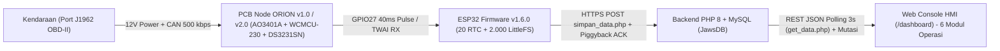

# ORION Telemetry & Digital Twin Workbench

**ORION (Onboard Reporting for Inventory & Operational Notifications)** adalah sistem telemetri IoT terpadu dan antarmuka *Digital Twin HMI* untuk pengawasan kesehatan aki 12V, pembacaan diagnostik OBD-II CAN bus (*100% Read-Only ECU*), penjadwalan antrean pemanasan mesin (*warm-up SOP 10 menit*), serta pelacakan presensi fisik kendaraan di area *stock yard*.

## Arsitektur Sistem End-to-End

## Pilar Utama Platform

| Lapisan | Teknologi | Tanggung Jawab Utama |
| :--- | :--- | :--- |
| **Edge Node & Sensing** | ESP32-WROOM-32, DS3231SN, SN65HVD230 | Mengukur voltase baterai lewat sakelar high-side P-MOSFET (`40 ms` pulsa) agar arus tidur tetap di bawah `500 uA`, membaca 15 PID Mode `0x01` & DTC Mode `0x03`, dan menyangga data hingga `2.020 slot` saat offline. |
| **Konektivitas Dual-SSID** | Wi-Fi Station Asinkron 4-Zona | Mengelola perpindahan otomatis antara AP Gudang (`YARD`), Hotspot Teknisi (`TECH_HOTSPOT`), dan mode pencatatan luring (`OFFLINE`) dengan anti-flapping gerbang dan pelacakan lag keluar mononotik. |
| **Backend & Basis Data** | PHP 8 + PDO MySQL 8 | Menyediakan endpoint ingesti dual-format (`simpan_data.php`), penyajian status langsung bermicro-cache (`get_data.php`), kendali konfigurasi NVS via Piggyback ACK, serta ekspor audit CSV & Excel 3-sheet. |
| **Digital Twin HMI** | React 19, TanStack Start, Vite 8, Recharts | Konsol pengawasan 6 modul yang terisolasi jujur antara mode **Simulator Sandbox** dan mode **Live MySQL API** tanpa fabrikasi telemetri saat node berada dalam mode tidur atau offline. |

## Peta Dokumentasi Teknis

1. **[Diagram Alir Data Sistem (DFD Level 0, 1, dan 2)](architecture/data-flow-dfd.md)**: alur data end-to-end dari pin OBD-II kendaraan hingga ingest server, buffer 2-tingkat, dan ekspor laporan.
2. **Hardware & Kelistrikan PCB**: [Peta Alur PCB v2.0 Step 2.1 & Memo Revisi](hardware/pcb-v2-blueprint-layout.md), [Alur Kelistrikan Lengkap PCB v2.0](hardware/electrical-flow.md), [Skematik & Proteksi Kelistrikan](hardware/electrical-schematic.md), [Pinout ESP32 & Header c23](hardware/pinout-and-wiring.md), dan [Manajemen Daya & Pulsa 40ms](hardware/power-budget.md).
3. **[Firmware ESP32 v1.6.0](firmware/telemetry-struct.md)**: paket biner terkompresi `88 byte`, [buffer dua tingkat RTC SRAM + LittleFS](firmware/two-tier-buffer.md), [mesin status 4-zona Wi-Fi](firmware/wifi-zone-handover.md), dan [protokol CAN read-only](firmware/obd2-can-protocol.md).
4. **[Backend PHP & Skema MySQL](backend-api/database-schema.md)**: relasi 6 tabel basis data, [kontrak sinkronisasi Piggyback ACK](backend-api/ingest-and-piggyback.md), [algoritma Mass Disconnect Guard](backend-api/live-polling-and-guard.md), serta [mutasi dua arah & generator laporan](backend-api/mutations-and-exports.md).
5. **[Algoritma & Prognostik](algorithms/adc-ols-calibration.md)**: regresi linear *Ordinary Least Squares* (OLS) kalibrasi DMM SOP C.1, [prognostik aki & penalti termal Arrhenius](algorithms/battery-prognostics.md), dan [pairing log keluar-masuk pra-NTP](algorithms/pre-ntp-clock-pairing.md).
6. **[Panduan HMI & Operasional](hmi-operations/module-01-topology.md)**: spesifikasi fungsi Modul `01` hingga `06` serta [arsitektur deployment Heroku dan CI/CD](hmi-operations/deployment-ci-cd.md).
