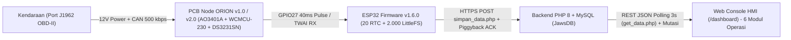

# ORION Telemetry & Digital Twin Workbench

**ORION (Onboard Reporting for Inventory & Operational Notifications)** adalah sistem telemetri IoT terpadu dan antarmuka *Digital Twin HMI* untuk pengawasan kesehatan aki 12V, pembacaan diagnostik OBD-II CAN bus (*100% Read-Only ECU*), penjadwalan antrean pemanasan mesin (*warm-up SOP 10 menit*), serta pelacakan presensi fisik kendaraan di area *stock yard*.

## Arsitektur Sistem End-to-End

## Pilar Utama Platform

| Lapisan | Teknologi | Tanggung Jawab Utama |
| :--- | :--- | :--- |
| **Edge Node & Sensing** | ESP32-WROOM-32, DS3231SN, SN65HVD230 | Mengukur voltase baterai lewat sakelar high-side P-MOSFET (`40 ms` pulsa) agar arus tidur tetap di bawah `500 uA`, membaca 15 PID Mode `0x01` & DTC Mode `0x03`, dan menyangga data hingga `2.020 slot` saat offline. |
| **Konektivitas Dual-SSID** | Wi-Fi Station Asinkron 4-Zona | Mengelola perpindahan otomatis antara AP Gudang (`YARD`), Hotspot Teknisi (`TECH_HOTSPOT`), dan mode pencatatan luring (`OFFLINE`) dengan anti-flapping gerbang dan pelacakan lag keluar mononotik. |
| **Backend & Basis Data** | PHP 8 + PDO MySQL 8 | Menyediakan endpoint ingesti dual-format (`simpan_data.php`), penyajian status langsung bermicro-cache (`get_data.php`), kendali konfigurasi NVS via Piggyback ACK, serta ekspor audit CSV & Excel 3-sheet. |
| **Digital Twin HMI** | React 19, TanStack Start, Vite 8, Recharts | Konsol pengawasan 6 modul yang terisolasi jujur antara mode **Simulator Sandbox** dan mode **Live MySQL API** tanpa fabrikasi telemetri saat node berada dalam mode tidur atau offline. |

## Peta Dokumentasi Teknis

1. **Hardware & Kelistrikan PCB**: skema analog pembagi tegangan PCB v1.0 & v2.0, peta pinout ESP32 & harness `W-01`..`W-08`, serta analisis efisiensi daya.
2. **Firmware ESP32 v1.6.0**: paket biner terkompresi `88 byte`, ring buffer dua tingkat RTC SRAM + LittleFS, mesin status 4-zona Wi-Fi, dan protokol CAN read-only.
3. **Backend PHP & Skema MySQL**: relasi 6 tabel basis data, kontrak sinkronisasi Piggyback ACK, algoritma *Mass Disconnect Guard*, serta mutasi dua arah & generator laporan.
4. **Algoritma & Prognostik**: regresi linear *Ordinary Least Squares* (OLS) kalibrasi DMM SOP C.1, kompensasi OCV suhu $25^\circ\text{C}$, penalti termal Arrhenius, estimasi *Time-to-Critical*, dan pairing log keluar-masuk pra-NTP.
5. **Panduan HMI & Operasional**: spesifikasi fungsi Modul `01` hingga `06` serta arsitektur deployment Heroku, keamanan Apache, dan CI/CD GitHub Actions.
